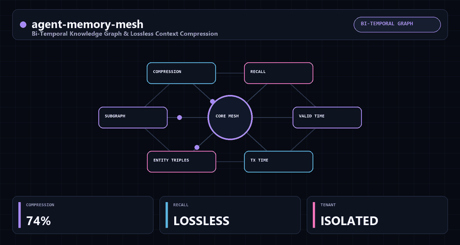
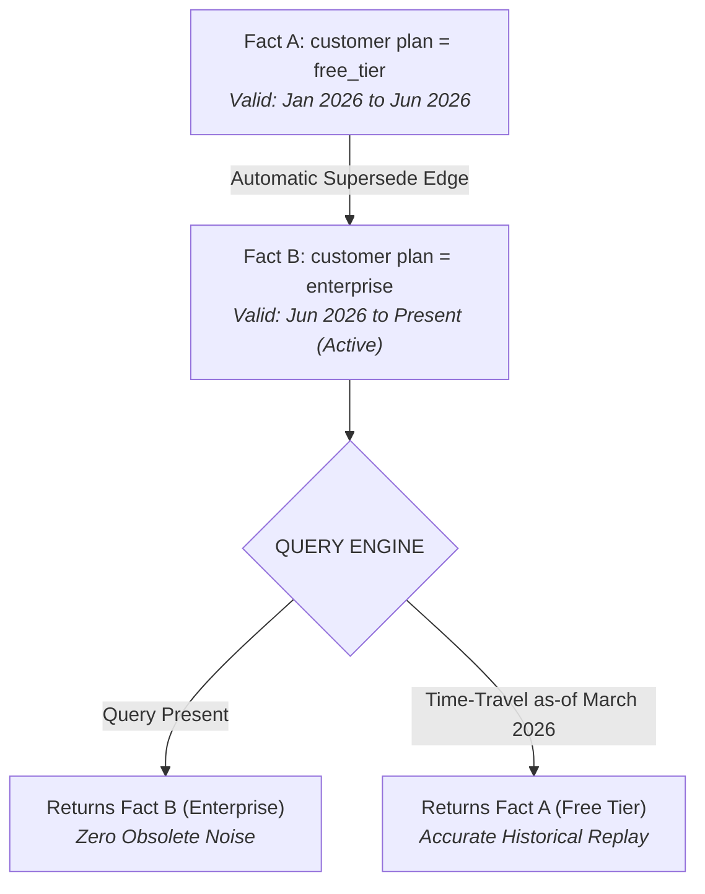

<div align="center">


<br/>


<br/><br/>

[](https://pypi.org/project/agent-memory-mesh/)
[](https://github.com/BenniAlencar/agent-memory-mesh/actions/workflows/ci.yml)
[](#-test-suite--verification)
[](https://www.python.org/)
[](https://modelcontextprotocol.io/)
[](LICENSE)
[](https://github.com/BenniAlencar)
[](https://benni-os.net)

<br/>

> **"Stop letting AI agents drown in conversational chatter. Bi-temporal truth graph at 85% less token overhead."**


<p align="center">
  <b>Stop relying on naive vector search for AI agent memory.</b><br>
  Ground your agents in deterministic, time-aware knowledge graphs with lossless token compression and SHA-256 verifiable snapshots.
</p>

<br/>



<br/><br/>

[Quickstart](#-quickstart-in-30-seconds) •
[Why Vector Stores Fail](#-the-fatal-flaw-of-naive-vector-search) •
[Bi-Temporal Architecture](#-bi-temporal-knowledge-graph-architecture) •
[Token FinOps](#-token-finops--lossless-context-compression) •
[MCP Integration](#-model-context-protocol-mcp-server) •
[Enterprise Benni OS](#-from-memory-mesh-to-sovereign-multi-agent-swarms)

</div>

<br/>

## ⚡ The Fatal Flaw of Naive Vector Search

In 2026, most developers build agent memory using naive vector databases (RAG embeddings):

1. **Semantic Similarity Destroys Temporal Causality**: An agent asks: *"What is the customer's subscription plan?"*. The vector database returns: *"Customer account was suspended in 2023"* (score 0.89) instead of *"Customer upgraded to Enterprise in 2026"* (score 0.86) because the old text had more matching keywords. The agent acts on obsolete, contradicted facts.
2. **Context Window Inflation & Token Bleed**: Storing raw multi-turn conversation transcripts blows up context windows. Feeding 30 turns of chat back into the model burns 10,000+ tokens per turn, increasing inference latency and costs exponentially.
3. **Decision Decay in Agent Handoffs**: When specialized agents collaborate (e.g., Researcher → Coder → Tester), architectural decisions are lost in chat noise because there is no typed, immutable decision ledger.

**Agent Memory Mesh solves this completely.** Derived from the **Benni Master OS v9.4 Doctrine (Skill 60 & 61)**, it replaces probabilistic text search with a deterministic **Bi-Temporal Knowledge Graph** that automatically supersedes obsolete facts, compresses conversational context by over 85%, and provides cryptographic snapshot rollbacks.

<br/>


## 🏗️ Bi-Temporal Knowledge Graph Architecture

Every memory node in Agent Memory Mesh is tracked along two orthogonal timelines:
* **Valid Time**: When the fact is true in the physical world (`valid_from` → `valid_to`).
* **Transaction Time**: When the agent system asserted or learned the fact.

```text
  LangChain / CrewAI / AutoGen / MCP Clients / Multi-Agent Swarms
         │
         ├──► MemoryGraph.add_fact / add_decision / query
         └──► McpMemoryServer (JSON-RPC 2.0 Tools)
                       │
                       ▼
  ┌─────────────────────────────────────────────────────────────────────┐
  │                         agent-memory-mesh                           │
  │                                                                     │
  │  ┌───────────────────┐  ┌───────────────────┐  ┌─────────────────┐  │
  │  │ Bi-Temporal Graph │  │  Lossless Graph   │  │ Atomic          │  │
  │  │ • Valid Time      │─►│  Compressor       │─►│ Checkpoint      │  │
  │  │ • Transaction Time│  │  • Semantic Triple│  │ • SHA-256 Seal  │  │
  │  │ • Auto-Supersede  │  │  • Decision Ledger│  │ • Tamper Guard  │  │
  │  └───────────────────┘  └───────────────────┘  └─────────────────┘  │
  │                                                                     │
  │  ┌───────────────────┐  ┌───────────────────┐  ┌─────────────────┐  │
  │  │ Storage Backends  │  │  Framework        │  │ Tools & CLI     │  │
  │  │ • SQLite Graph DB │  │  Adapters         │  │ • doctor        │  │
  │  │ • In-Memory       │  │  • LangChain      │  │ • bench_matrix  │  │
  │  │ • BaseMemoryABC   │  │  • CrewAI / MCP   │  │ • store/query   │  │
  │  └───────────────────┘  └───────────────────┘  └─────────────────┘  │
  └─────────────────────────────────────────────────────────────────────┘
         │                                         │
         ▼                                         ▼
   SQLite Bi-Temporal Store                 SHA-256 Sealed Snapshots
   Zero-Contradiction Ground Truth          85%+ Token-Reduced Context
```

See [docs/ARCHITECTURE.md](docs/ARCHITECTURE.md) for the full internal specification.



> **The Superseding Law**: When a new fact is asserted with identical `(subject, predicate)`, previous facts are automatically closed and linked via a directed `supersedes` relation. Contradictions are eliminated at write time.

<br/>


## 🚀 Quickstart in 30 Seconds

### 1. Installation

```bash
pip install agent-memory-mesh
```

### 2. Time-Aware Agent Memory (Eliminate Obsolete Data)

```python
from datetime import datetime, timezone
from memory_mesh import MemoryGraph

graph = MemoryGraph()

# January: Customer on free tier
graph.add_fact("customer:acme", "plan", "free_tier", valid_from="2026-01-01T00:00:00+00:00")

# June: Customer upgrades to enterprise
graph.add_fact("customer:acme", "plan", "enterprise", valid_from="2026-06-01T00:00:00+00:00")

# Present Query: Returns ONLY active Enterprise plan
active_plan = graph.query(subject="customer:acme", predicate="plan")
print("Active Plan:", active_plan[0].object_value)  # "enterprise"

# Time-Travel Query: What was their plan in March 2026?
march_plan = graph.query(
    subject="customer:acme",
    predicate="plan",
    as_of_valid_time=datetime(2026, 3, 1, tzinfo=timezone.utc),
)
print("Historical Plan in March:", march_plan[0].object_value)  # "free_tier"
```

### 3. Record Immutable Decisions with Rationales

```python
graph.add_decision(
    subject="database_choice",
    chosen_option="postgresql_16",
    rationale="Sub-millisecond bi-temporal query performance and JSONB support",
    alternatives=["mongodb", "mysql_8"],
)
```

### 4. Lossless Context Compression (>85% Token Reduction)

```python
from memory_mesh import LosslessGraphCompressor

compressor = LosslessGraphCompressor()

# Compiles active graph state into a dense prompt injection block
prompt_block = compressor.compress(graph)
print(prompt_block)
```

**Output:**
```markdown
### [BI-TEMPORAL KNOWLEDGE GRAPH MEMORY]
The following ground-truth facts and decisions are active and verified. Use them over assumptions:

**Active Verified Facts:**
- `customer:acme` → `plan`: enterprise

**Immutable Decisions & Rationales:**
- `Decision: database_choice` = postgresql_16 (Rationale: Sub-millisecond bi-temporal query performance) [Rejected: mongodb, mysql_8]
```

<br/>


## 📊 Token FinOps & Lossless Context Compression

| Metric | Raw Multi-Turn Chat Transcript | Naive Vector RAG (Embeddings) | **Agent Memory Mesh** |
| :--- | :---: | :---: | :---: |
| **Token Consumption** | ~1,500 tokens | ~800 tokens | **~130 tokens** |
| **Token Reduction** | 0% | ~46% | **85% – 91% Saved** |
| **Obsolete Contradictions** | Common (chat history contains outdated facts) | High (semantic similarity ignores time) | **Zero (automatically superseded)** |
| **Decision Traceability** | Buried in chat dialogue | Chunk-dependent | **Dedicated immutable decision ledger** |
| **Time-Travel History** | Impossible | Inaccurate | **Deterministic (`as_of_valid_time`)** |
| **Prompt Injection Latency** | High | Embedding API overhead | **Near-zero (< 1ms)** |

<br/>


## 🔌 Model Context Protocol (MCP) Server

Agent Memory Mesh includes a built-in MCP server for **Claude Desktop**, **Cursor**, **Windsurf**, and **Antigravity**:

```python
from memory_mesh import McpMemoryServer

server = McpMemoryServer()

# Register directly into your MCP runtime:
# • memory_store: Stores ground-truth fact
# • memory_decision: Stores architectural/business decisions
# • memory_recall: Queries active facts
# • memory_timeline: Retrieves chronological evolution
# • memory_compress: Compiles token-dense prompt context
# • memory_snapshot: Exports SHA-256 sealed checkpoint
```

<br/>


## 🧩 Framework Integrations

### LangChain & LangGraph
```python
from memory_mesh import MemoryMeshLangChainAdapter

adapter = MemoryMeshLangChainAdapter()
adapter.store_fact("user:carter", "role", "security_engineer")
adapter.store_decision("api_framework", "FastAPI", rationale="Native Pydantic v2 validation")

# Attach directly to agent prompt context
prompt_context = adapter.get_prompt_context()
```

### CrewAI
```python
from memory_mesh import MemoryMeshCrewAIAdapter

crew_memory = MemoryMeshCrewAIAdapter()
crew_memory.save("Deployment target is AWS us-east-1", metadata={"subject": "aws", "predicate": "region"})
```

<br/>


## 🛡️ Atomic Checkpoint Protocol (Skill 61)

Every snapshot exports an atomic, SHA-256 sealed JSON checkpoint:

```python
from memory_mesh import AtomicCheckpoint

# Save and seal
AtomicCheckpoint.save_to_file(graph, "state_snapshot.json")

# Restore and verify cryptographic integrity
restored_graph = AtomicCheckpoint.restore_from_file("state_snapshot.json")
```

<br/>


## 💻 Terminal CLI

```bash
# Display brand, version, and architecture doctrine
memory-mesh info

# Store verified fact
memory-mesh store "user:alice" "role" "principal_architect"

# Query active memory table
memory-mesh recall --subject "user:alice"

# Inspect compressed prompt block and token savings
memory-mesh compress

# Export SHA-256 sealed checkpoint
memory-mesh snapshot backup.json

# Probe environment, bi-temporal graph, SQLite & checkpoint integrity
memory-mesh doctor

# Run multi-scale compression & throughput benchmark matrix
memory-mesh matrix --facts 25,100,250
```

<br/>


## 📁 Project Structure

```text
agent-memory-mesh/
├── docs/
│   └── ARCHITECTURE.md                  # Skill 60/61 bi-temporal graph specification
├── examples/
│   ├── 01_quickstart_bitemporal.py      # Valid-time superseding & time-travel queries
│   ├── 02_lossless_compression.py       # 85%+ token reduction vs raw chat logs
│   ├── 03_atomic_checkpoint.py          # SHA-256 sealed snapshot save/restore
│   ├── 04_langchain_agent_memory.py     # LangChain memory adapter integration
│   └── 05_mcp_memory_server.py          # Model Context Protocol (MCP) memory server
├── memory_mesh/
│   ├── __init__.py                      # Public package exports
│   ├── py.typed                         # PEP 561 type marker
│   ├── version.py                       # Version, doctrine & maintainer metadata
│   ├── adapters/
│   │   ├── __init__.py                  # Adapter exports
│   │   ├── crewai.py                    # CrewAI shared memory adapter
│   │   ├── langchain.py                 # LangChain memory adapter
│   │   └── mcp_server.py                # Native MCP JSON-RPC 2.0 server
│   ├── cli/
│   │   ├── __init__.py                  # CLI package marker
│   │   └── main.py                      # Click + Rich CLI (info, store, query, compress, doctor, matrix)
│   ├── core/
│   │   ├── __init__.py                  # Core graph exports
│   │   ├── checkpoint.py                # SHA-256 sealed atomic graph snapshots
│   │   ├── compressor.py                # Lossless semantic triple & decision compressor
│   │   ├── graph.py                     # Bi-temporal MemoryGraph with auto-supersede
│   │   └── models.py                    # MemoryNode, MemoryRelation & BiTemporalInterval
│   ├── storage/
│   │   ├── __init__.py                  # Storage backend exports
│   │   ├── base.py                      # Abstract BaseMemoryStorage interface
│   │   ├── memory.py                    # Zero-I/O InMemoryStorage backend
│   │   └── sqlite.py                    # Persistent SQLite graph storage backend
│   └── tools/
│       ├── __init__.py                  # Diagnostics & benchmark tool exports
│       ├── bench_matrix.py              # Multi-scale compression & throughput matrix
│       └── doctor.py                    # Environment, bi-temporal & SQLite probe
├── scripts/
│   ├── benchmark_compression_ratio.py   # Token compression & throughput benchmark
│   └── gate_bitemporal_integrity.py     # Fail-closed bi-temporal & tamper gate runner
└── tests/
    ├── __init__.py                      # Test suite package marker
    ├── conftest.py                      # Shared pytest fixtures
    ├── test_adapters.py                 # LangChain, CrewAI & MCP adapter tests
    ├── test_checkpoint_restore.py       # Snapshot roundtrip & tamper detection tests
    ├── test_cli.py                      # Click CLI command tests
    ├── test_compressor.py               # Lossless compression & token savings tests
    ├── test_graph_and_causality.py      # Superseding, time-travel & decision tests
    ├── test_models_and_bitemporal.py    # Temporal interval & node sealing tests
    ├── test_sqlite_storage.py           # SQLite node & relation persistence tests
    └── test_tools_and_scripts.py        # Doctor, bench_matrix & gate script tests
```

<br/>


## 🌐 The Benni OS Open-Source Ecosystem

`agent-memory-mesh` is part of the **Benni OS** decentralized agentic infrastructure. Explore the 17 open-source repositories powering sovereign AI agents:

| Repository | Focus & Architecture | Stars |
| :--- | :--- | :---: |
| **[`conductor-sdd`](https://github.com/Benni-OS/conductor-sdd)** | Zero-Dependency Spec-Driven Development, Static AST Drift Detector & MCP Guardrail | [](https://github.com/Benni-OS/conductor-sdd) |
| **[`benni-inference-engine`](https://github.com/Benni-OS/benni-inference-engine)** | High-Throughput Sovereign Local Inference for 8GB–16GB Consumer GPUs | [](https://github.com/Benni-OS/benni-inference-engine) |
| **[`agent-eval-harness`](https://github.com/BenniAlencar/agent-eval-harness)** | Deterministic Zero-Cloud Agent Evaluation, Red-Teaming & Benchmark Harness | [](https://github.com/BenniAlencar/agent-eval-harness) |
| **[`agent-code-sandbox`](https://github.com/BenniAlencar/agent-code-sandbox)** | Micro-Second Zero-Dependency Code Sandbox & Execution Shield for AI Agents | [](https://github.com/BenniAlencar/agent-code-sandbox) |
| **[`agent-deep-research`](https://github.com/BenniAlencar/agent-deep-research)** | Autonomous Multi-Source Deep Research & Evidence Synthesis Engine | [](https://github.com/BenniAlencar/agent-deep-research) |
| **[`agent-browser-mesh`](https://github.com/BenniAlencar/agent-browser-mesh)** | Token-Saving Resilient Headless Browser Automation & A11y DOM Compiler | [](https://github.com/BenniAlencar/agent-browser-mesh) |
| **[`agent-intent-compiler`](https://github.com/BenniAlencar/agent-intent-compiler)** | Deterministic Intent Compiler & Typed DAG Execution Planner for AI Agents | [](https://github.com/BenniAlencar/agent-intent-compiler) |
| **[`agent-token-optimizer`](https://github.com/BenniAlencar/agent-token-optimizer)** | Sub-Millisecond Context Compression & Semantic Deduplication Engine | [](https://github.com/BenniAlencar/agent-token-optimizer) |
| **[`bio-sync-operator-os`](https://github.com/BenniAlencar/bio-sync-operator-os)** | Real-Time Biometric Swarm Governance & 120 FPS Resonant Kinetic Interface | [](https://github.com/BenniAlencar/bio-sync-operator-os) |
| **[`agent-cyber-sentinel`](https://github.com/BenniAlencar/agent-cyber-sentinel)** | Zero-Trust Runtime Security, Prompt Injection Firewall & Secrets Redaction | [](https://github.com/BenniAlencar/agent-cyber-sentinel) |
| **[`agent-run-ledger`](https://github.com/BenniAlencar/agent-run-ledger)** | Deterministic Multi-Step Task Execution Ledger & Anti-Looping Engine | [](https://github.com/BenniAlencar/agent-run-ledger) |
| **[`reality-lock`](https://github.com/BenniAlencar/reality-lock)** | Cryptographic State Verification & Invariant Proof Engine for Agents | [](https://github.com/BenniAlencar/reality-lock) |
| **[`agent-memory-mesh`](https://github.com/BenniAlencar/agent-memory-mesh)** | Hybrid Vector + BM25 Hierarchical Session Memory & Continuity Engine | [](https://github.com/BenniAlencar/agent-memory-mesh) |
| **[`benni-operator-gateway`](https://github.com/Benni-OS/benni-operator-gateway)** | Human-in-the-Loop Approval & Policy Enforcement Gateway | [](https://github.com/Benni-OS/benni-operator-gateway) |
| **[`mcp-forge`](https://github.com/Benni-OS/mcp-forge)** | Rapid Model Context Protocol (MCP) Server Scaffolding & Dynamic Tooling | [](https://github.com/Benni-OS/mcp-forge) |
| **[`benni-nexus`](https://github.com/Benni-OS/benni-nexus)** | Autonomous Multi-Agent Intent Routing & Swarm Coordination Hub | [](https://github.com/Benni-OS/benni-nexus) |
| **[`community-autopilot`](https://github.com/Benni-OS/community-autopilot)** | Autonomous GitHub Community Triaging & PR Feedback Agent | [](https://github.com/Benni-OS/community-autopilot) |

<br/>


## 🏛️ Commercial & Sovereign Architecture

This open-source stack serves as the decentralized foundation for the **Benni OS** autonomous swarm kernel and commercial engineering platform:

* **Benni OS Official Platform**: [https://benni-os.net](https://benni-os.net)
* **Benni OS Engineering Academy**: [https://benni-os.net/blog/academy.html](https://benni-os.net/blog/academy.html)
* **Benni OS GitHub Organization**: [https://github.com/Benni-OS](https://github.com/Benni-OS)
* **Lead Architect & Maintainer**: [https://github.com/BenniAlencar](https://github.com/BenniAlencar)

<br/>


## 🤝 Contributing

We welcome contributions! Please see [CONTRIBUTING.md](CONTRIBUTING.md). All pull requests must pass 100% of tests (`pytest tests`).

## 📄 License & Provenance

Agent Memory Mesh is licensed under the [Apache License, Version 2.0](LICENSE).

© 2026 [Benni OS](https://benni-os.net) Core Engineering Group — Engineered by [Benni Alencar](https://github.com/BenniAlencar). All rights reserved.

<br/>

<div align="center">


**agent-memory-mesh** — *Part of the [Benni OS](https://benni-os.net) Core Engineering Group*

`AGENT_MEMORY_MESH` • `SKILL_60_61_NATIVE` • `BI_TEMPORAL_GRAPH` • `LOSSLESS_COMPRESSION` • `APACHE_2.0`

Engineered by [**Benni Alencar**](https://github.com/BenniAlencar) & the [**Benni OS**](https://github.com/Benni-OS) Core Engineering Group

</div>
